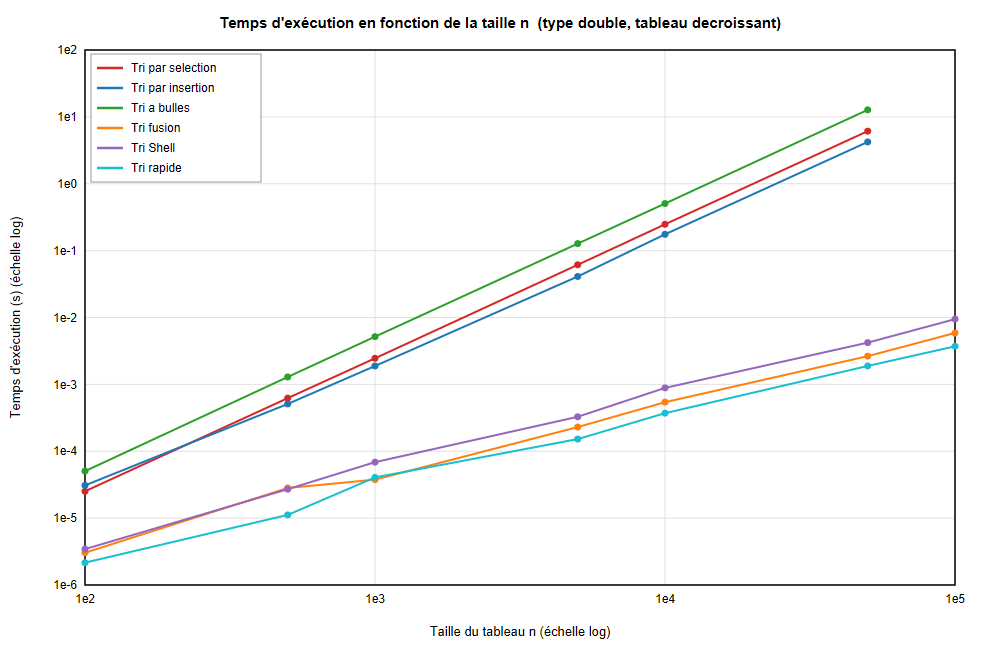

# Benchmark & Visualiseur d'Algorithmes de Tri en C

Application modulaire en C (C99) permettant l'implémentation, l'analyse comparative de performances et la visualisation graphique interactive d'algorithmes de tri classiques et avancés.

Ce projet propose deux modes d'utilisation :
1. **Mode Console** : génération de tableaux (aléatoires, triés, inversés, avec doublons), mesure précise des temps d'exécution et export des métriques au format CSV.
2. **Mode Graphique (GTK 4)** : interface utilisateur multifenêtre permettant de configurer les benchmarks, d'observer la progression et de tracer en temps réel les courbes comparatives de complexité algorithmique.

---

## 🎯 Objectifs pédagogiques
- **Algorithmique & Complexité** : Étude expérimentale et théorique des complexités temporelles en O(n²) et O(n log n).
- **Programmation C bas niveau** : Gestion rigoureuse de la mémoire, pointeurs de fonctions pour les stratégies de tri, découpage modulaire en unités de compilation `.c` / `.h`.
- **Développement d'interfaces en C** : Conception d'une interface graphique moderne avec **GTK 4** et tracé vectoriel avec **Cairo**.
- **Automatisation & Outillage** : Construction multi-cibles via `Makefile` et intégration avec l'IDE Code::Blocks.

---

## 🚀 Algorithmes implémentés

| Algorithme | Complexité Meilleur cas | Complexité Cas moyen | Complexité Pire cas | Stabilité |
| :--- | :---: | :---: | :---: | :---: |
| **Tri à bulles** (*Bubble Sort*) | O(n) | O(n²) | O(n²) | Oui |
| **Tri par sélection** (*Selection Sort*) | O(n²) | O(n²) | O(n²) | Non |
| **Tri par insertion** (*Insertion Sort*) | O(n) | O(n²) | O(n²) | Oui |
| **Tri rapide** (*Quicksort*) | O(n log n) | O(n log n) | O(n²) | Non |
| **Tri fusion** (*Mergesort*) | O(n log n) | O(n log n) | O(n log n) | Oui |

---

## 📂 Structure du projet

```text
benchmark-algorithmes-tri-c/
├── Makefile                # Configuration de compilation multi-cibles
├── README.md               # Documentation du projet
├── .gitignore              # Exclusion des binaires et objets
├── data/
│   └── resultats.csv       # Exemple d'export de mesures de temps
├── docs/
│   └── courbes.png         # Graphique comparatif généré par l'application
└── src/
    ├── bench.c / .h        # Moteur de benchmarking et chronométrage
    ├── courbes_dessin.c/.h # Tracé graphique des courbes de performance
    ├── generate.c / .h     # Générateurs de jeux de données de test
    ├── gui_*.c             # Modules de l'interface graphique GTK 4
    ├── main_console.c      # Point d'entrée pour la version ligne de commande
    ├── main_gui.c          # Point d'entrée pour l'application graphique GTK 4
    ├── sorts.c / .h        # Implémentation des 5 algorithmes de tri
    ├── state.c / .h        # Gestion de l'état de l'application
    └── style.css           # Feuilles de style pour l'interface GTK
```

---

## 🛠️ Compilation et exécution

### Prérequis
- Compilateur **GCC** (`gcc`)
- **Make**
- *(Optionnel pour le mode GUI)* Bibliothèque **GTK 4** et `pkg-config`

### 1. Version Console
```bash
make console
./tri_console
```

### 2. Version Graphique GTK 4
```bash
make gui
./tri_gui
```

### 3. Nettoyage des binaires
```bash
make clean
```

---

## 📊 Résultats & Visualisation

L'application permet d'exporter les temps mesurés (en millisecondes) selon la taille $n$ du tableau et la distribution des données initiales.

Exemple de courbe comparative générée :


---

## 👤 Auteur
**Imad Ezzahid** ([@imad27-maker](https://github.com/imad27-maker)) — Étudiant en Licence Sciences et Techniques (Informatique)